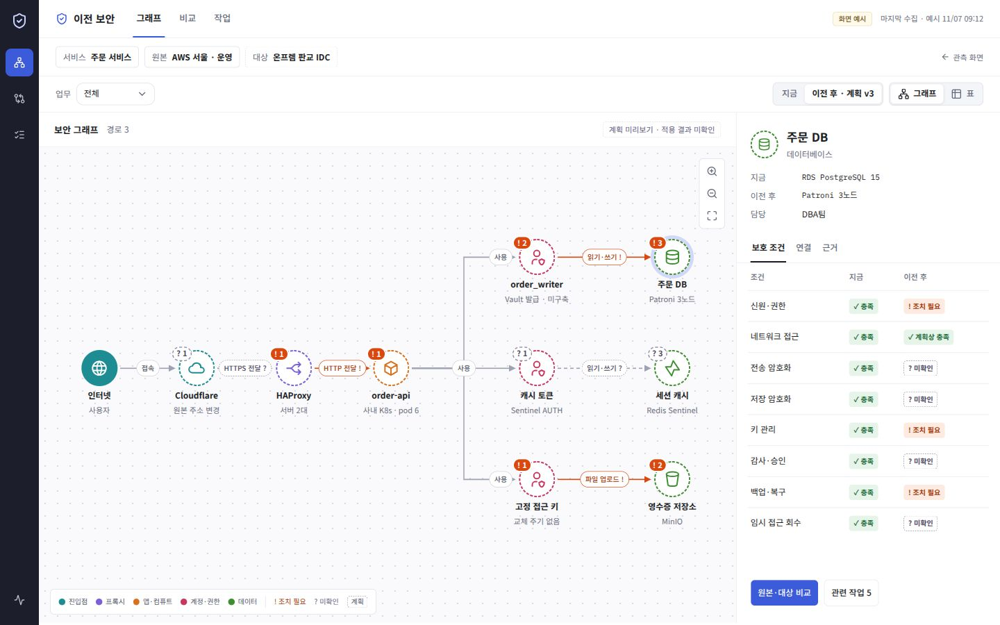
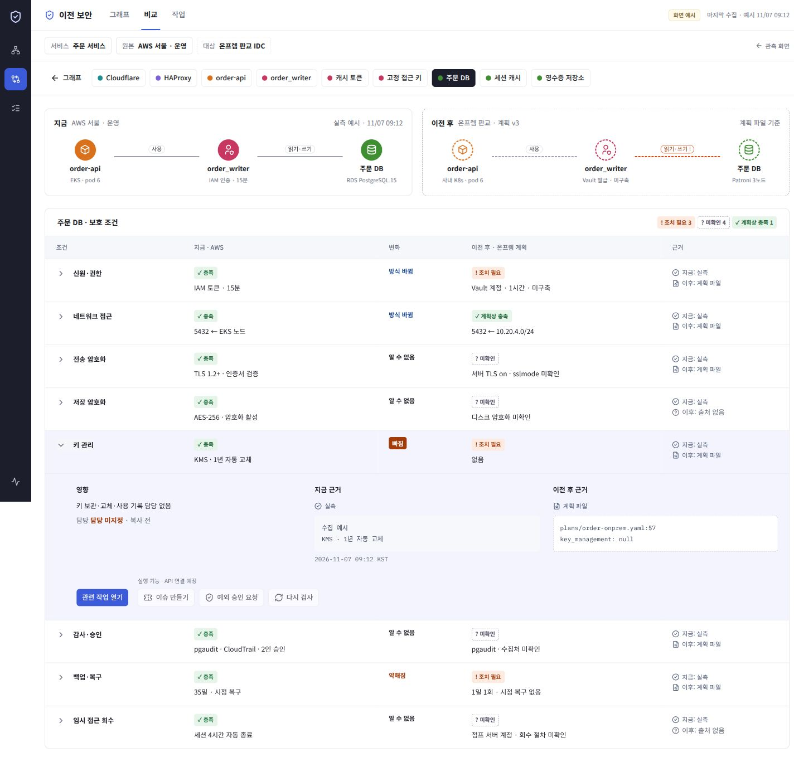
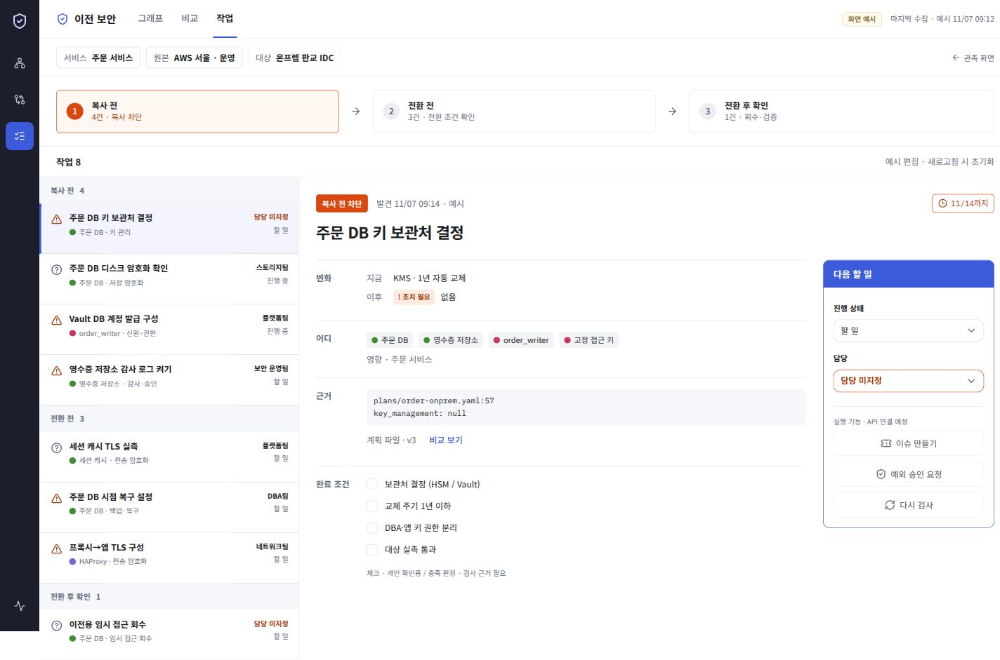

# 마이그레이션 보안 화면

`/security`에 그래프·비교·작업 화면을 추가했습니다. 기존 `/` 관측 화면과 서로 이동할 수 있습니다.

기준: [handoff SPEC](https://github.com/SuperSon7/migration-security-dashboard-handoff/blob/192e58424a0183b09f16763f097d8ae837352f80/SPEC.md), 커밋 `192e584`. `release/2`의 `952ca60`에서 작업했습니다.

## 실행과 범위

```bash
vp install --frozen-lockfile
vp dev --port 4186 --strictPort
# http://127.0.0.1:4186/security
vp run check
vp run build
```

- 그래프: 업무 필터, 지금/계획, 그래프/표, 확대·축소·맞춤, 노드·연결 선택, 보호 조건·연결·근거 패널.
- 비교: 자원 전환, 접근 경로 비교, 8개 보호 조건, 행 펼침과 근거, 관련 작업 이동. 없는 작업은 현재 화면에 예시 작업으로 추가합니다.
- 작업: 단계·자원 필터, 목록·상세, 담당과 진행 상태 변경, 개인 확인 체크리스트.
- 화면 간 선택한 자원을 유지합니다. 상단 탭은 URL hash를 사용하므로 뒤로 가기와 직접 진입이 가능합니다.
- 예시 작업 편집은 메모리에서만 유지합니다. 새로고침하면 초기화됩니다. 체크리스트는 작업 화면을 벗어나면 초기화됩니다.

모든 서비스·상태·파일 경로·시각은 화면 검토용 예시입니다. 원격 설정을 조사한 결과가 아닙니다. API 호출, AI 호출, 외부 이슈 생성, 예외 승인, 환경 변경은 없습니다. 이슈·예외·재검사 버튼은 비활성화했습니다. 작업 진행 상태와 개인 체크는 보호 조건·차단 판정을 바꾸지 않습니다.

실측과 계획 파일을 구분합니다. 계획의 `ok`는 **계획상 충족**으로 표시하며 대상 환경의 실측 통과를 뜻하지 않습니다. 적용 결과 화면, 요약, 수집 이력, 대규모 그래프 편집, 예외 승인 폼은 범위 밖입니다. AI 질문창·추천·초안 카드도 이번에는 넣지 않았습니다.

## 코드 위치

| 파일                                         | 책임                                 |
| -------------------------------------------- | ------------------------------------ |
| `src/app/app.tsx`                            | `/security` 진입과 lazy loading      |
| `src/pages/migration-security/model/demo.ts` | 타입, 예시 자원·연결·8개 조건·작업   |
| `ui/security-page.tsx`                       | 선택 상태, 화면 이동, 예시 작업 편집 |
| `ui/graph-view.tsx`                          | 지도·표와 자원 상세                  |
| `ui/compare-view.tsx`                        | 지금/계획 비교와 근거 펼침           |
| `ui/tasks-view.tsx`                          | 단계별 작업과 담당·상태 편집         |
| `ui/primitives.tsx`, `ui/security.css`       | 공통 상태·근거 표현, 화면 스타일     |

기존 React·TypeScript·Tailwind·shadcn 구성을 사용합니다. 그래프는 고정된 요청 경로를 SVG와 shadcn 버튼으로 표현하며 별도 그래프 라이브러리를 추가하지 않았습니다. 기본 shadcn 파일을 수정하지 않았습니다. `native-select`, `checkbox`만 CLI로 생성해 원본 검사에 등록했습니다. Noto Sans KR·IBM Plex Mono는 자체 호스팅 폰트 패키지로 로드합니다.

자원 SVG는 핸드오프에 제공된 Tabler outline 경로를 사용합니다. 원본: [Tabler Icons](https://github.com/tabler/tabler-icons), MIT, Copyright (c) 2020–2026 Paweł Kuna. 라이선스 전문은 `public/licenses/`에 포함했습니다. UI 조작 아이콘은 저장소의 기존 Lucide를 사용합니다.

## 컨트롤 플레인 연결 시

이 화면의 데이터 타입은 예시입니다. 새 API가 구현되었다는 뜻이 아닙니다.

1. 이 slice의 `api/`에 CP 조회 응답 스키마·Axios 함수·TanStack Query를 추가합니다. `model/demo.ts` 사용을 명시적인 개발 미리보기로 한정합니다. 오류를 예시 데이터로 바꾸지 않습니다.
2. 자원·연결·조건·작업을 workspace, workflow, service와 함께 조회합니다. 원본 수집 시각, 계획 버전, 근거 ID·출처, 적용/실측 시각을 각각 받습니다.
3. 게이트별 차단 여부·이유·필수 조건은 CP 응답을 사용합니다. 현재 화면의 작업 개수는 예시 목록의 건수이며 실제 실행 허용 판단이 아닙니다.
4. 작업의 상태·담당 변경은 서버 mutation으로 연결합니다. 저장 실패/진행 상태를 표시하고 관련 query만 갱신합니다. 완료 판정은 검사 근거와 서버 결과를 따릅니다.
5. 예외에는 범위·승인자·만료·사유가 필요합니다. 예외나 작업 완료를 `PASS`로 자동 변환하지 않습니다. 계획 파일 변경 시 기존 근거의 적용 가능성을 다시 확인합니다.

AI 후속 범위는 [AI 연결 메모](migration-security-ai-handoff.md)에 정리했습니다.

운영 호스팅에서 `/security` 직접 진입을 지원하려면 SPA fallback을 `index.html`로 설정해야 합니다. 이번 작업은 배포하지 않았습니다.

## 검증

- `vp run check`: 포맷·린트·타입·FSD·shadcn 원본 검사 통과, 기존 테스트 9개 통과.
- `vp run build`: 프로덕션 빌드 통과.
- 브라우저: 그래프→비교→관련 작업, 노드·연결 선택, 업무 필터와 표 전환, 지금/계획 전환, 작업 생성·담당·진행 상태·체크리스트 확인.
- 1440×900, 390×844에서 배치 확인. 좁은 화면의 그래프·표는 자체 스크롤을 사용합니다. 화면 맞춤은 전체 경로를 축소합니다.
- 보안 화면의 브라우저 오류 로그 없음. 실제 CP 연결·AI·배포 검증은 범위 밖입니다.

| 그래프                                    | 비교                                      | 작업                                    |
| ----------------------------------------- | ----------------------------------------- | --------------------------------------- |
|  |  |  |
